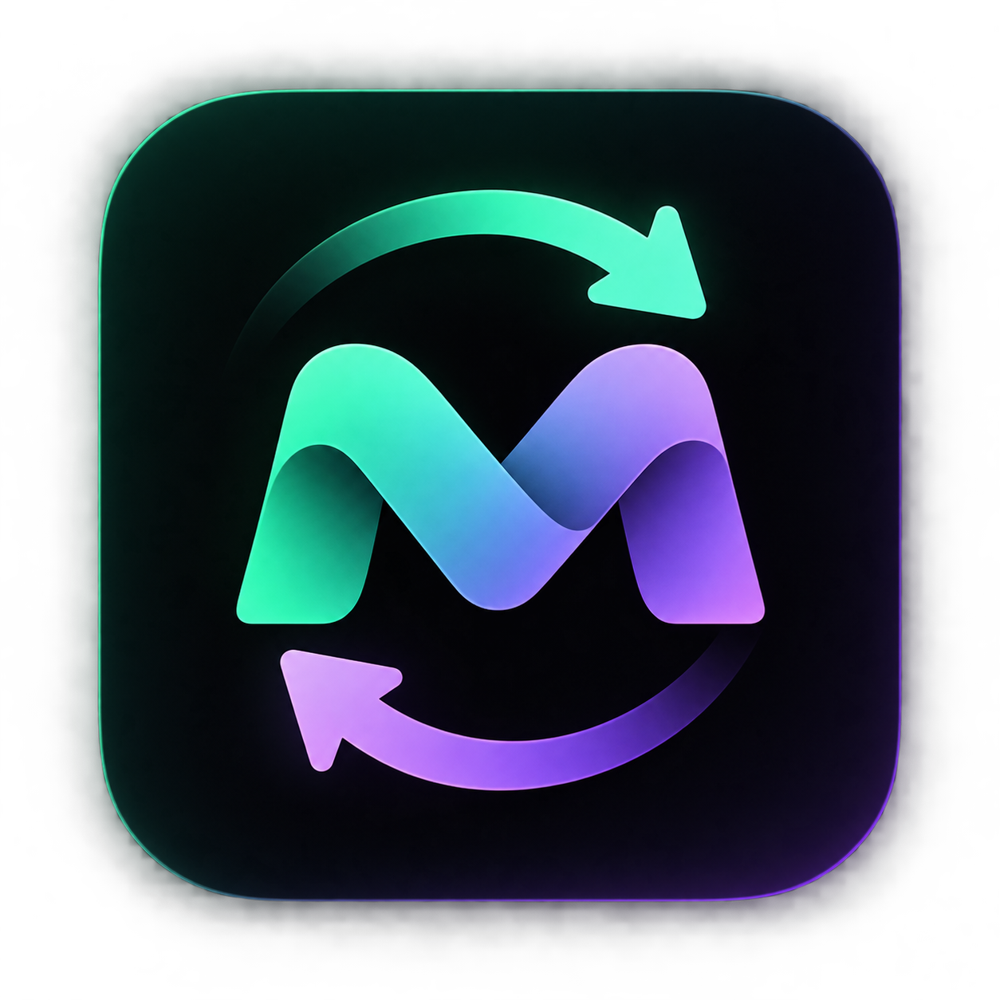
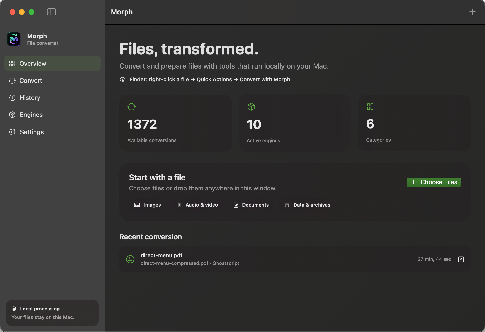

# Morph

Morph is a native SwiftUI macOS utility for converting and transforming files with Apple frameworks and optional local engines. It preserves inputs, writes collision-safe outputs, and keeps file processing on your Mac.





## What works today

- Finder conversion submenu implementation: a correctly signed and enabled build shows **Convert To → Convert with Morph → PNG → JPEG (.jpg)**-style choices directly in Finder. The main Morph window and a format-picker window stay closed; this Mac's ad-hoc build does not currently expose the Finder menu.
- Drag and drop or select multiple files in the app. Mixed selections can be batch-converted when every input shares the chosen output route.
- Runtime format discovery from Apple ImageIO, FFmpeg codecs and containers, ImageMagick, Pandoc, Poppler and LibreOffice.
- Fallback to another registered engine when a higher-priority adapter fails and a second route exists.
- Native image conversion and image-to-PDF, audio/video conversion, document conversion, PDF text extraction, JSON/YAML/TOML/CSV/TSV/XML data transformations, ZIP/TAR.GZ repackaging and optional ZIP ↔ 7z conversion.
- Additional operations include 50% image resizing, merging selected PDFs, extracting selected PDF page ranges, splitting a PDF into pages, preset-based PDF compression, extracting ZIP archives, trimming video and compressing one or more selected videos to H.264 MP4.
- Video compression offers smaller-file, balanced and higher-quality settings, plus maximum resolution choices of 1080p, 720p or the source size. Morph reports actual size changes because already-compressed inputs may produce larger files.
- A dedicated Operations page previews numbered batch-renamed copies, preserves each full filename and extension, and leaves the original files unchanged.
- Read-only image and PDF metadata inspection, including image dimensions and available camera fields, or PDF page count and document attributes.
- Route-aware conversion presets for Images to JPEG, Images to WebP at 80% quality, Video to MP4 with H.264, audio extraction to MP3 and Documents to PDF. Presets appear only when every selected file has the required locally available output route.
- Output beside the source, in `~/Documents/Morph Output`, or in a chosen folder. Existing files are never replaced.
- Local conversion history, progress, cancellation for conversions, and optional Finder reveal after completion.
- An engine manager that requires an explicit confirmation before installing, updating or uninstalling Homebrew formulas.
- A native Liquid Glass primary action on macOS 26 and later, with a bordered-button fallback on macOS 14–25.

## Finder workflow

Morph embeds a sandboxed Finder Sync extension. In Finder's contextual menu, **Convert To → Convert with Morph** opens a submenu whose items identify the source formats and show output routes available for every selected file. Choosing a row sends the selection and output format to Morph's accessory helper. The helper rechecks the route and runs conversion in the background; neither Morph's main window nor a format-picker window opens. A small menu-bar status item provides progress and cancellation. The Finder extension currently advertises native ImageIO, PDF and structured-data routes; media and optional-engine routes remain available in Morph's main app.

Finder does not let an Automator Quick Action add a dynamic submenu to its built-in **Quick Actions** section. Morph's submenu therefore appears as a separate native Finder contextual-menu item, not inside **Quick Actions**. Finder Sync supports dynamic menus based on `selectedItemURLs()`, but Apple describes it as a sync-oriented extension point and cautions against using it as a general Finder UI customization mechanism. Morph monitors the current user's home folder, mounted volumes, network shares and `/Users/Shared`; temporary files outside those locations do not receive the menu. Ad-hoc development builds may not be surfaced by Finder; public distribution requires a valid Developer ID signature and notarization. Users can enable or disable a signed Morph extension under **System Settings → General → Login Items & Extensions → Finder Extensions**. See [Apple's Finder Sync guidance](https://developer.apple.com/library/archive/documentation/General/Conceptual/ExtensibilityPG/Finder.html) and [`menu(for:)`](https://developer.apple.com/documentation/findersync/1501586-fifindersync/1501585-menuformenukind).

## Format availability

Morph shows a conversion only when the detected input capability, output capability and required engine are available on the current Mac. FFmpeg output choices are filtered by the installed muxers and required encoders. The list below describes implemented families; it does not claim that every extension in each family converts to every other extension.

| Family | Implemented routes and operations |
|---|---|
| Images | Apple ImageIO formats available on this macOS install; optional ImageMagick routes when detected. Image resizing writes JPEG. |
| Audio and video | FFmpeg routes based on this installed FFmpeg build's input demuxers, output muxers and required encoders. Includes audio extraction, video trimming and batch compression to H.264/AAC MP4 with configurable quality and maximum resolution. |
| Documents | Pandoc routes for detected reader/writer formats; LibreOffice converts within text-document or presentation families and exports those files to PDF. PDF text extraction uses Poppler. |
| Spreadsheets and data | LibreOffice converts within spreadsheet formats and exports them to PDF; Morph converts JSON, YAML/YML and TOML between one another and to/from CSV/TSV. XML bridges to JSON, YAML/YML and TOML. CSV/TSV and TOML record conversions use arrays of objects; a top-level array becomes a TOML `records` table. |
| Archives | ZIP ↔ TAR.GZ repackaging, ZIP extraction, and ZIP ↔ 7z conversion when 7-Zip is installed. Archive paths are checked before extraction; the 7-Zip adapter rejects link entries and checks extracted links for escapes. |
| PDF operations | Image-to-PDF, merge selected PDFs, extract ordered page ranges or split into pages with PDFKit; Ghostscript PDF compression with Compact, Balanced and Print quality presets. |

The format registry includes other candidate types, but unsupported candidates are not shown as conversion choices. 7-Zip currently handles ZIP ↔ 7z; RAR conversion, RAW processing, font conversion, CAD, geospatial and scientific formats have no active routes. Structured-data conversions accept UTF-8 and JSON-compatible values; YAML input must contain one document. Parser limits protect input size, nesting, collection lengths and table sizes. TOML requires a top-level table; CSV/TSV conversion requires records with matching string fields. Metadata editing is not implemented. Batch rename creates numbered copies in the configured output location; it never renames or replaces the selected originals. Video trimming and compression re-encode to H.264/AAC; quality can change, subtitles may be dropped and some metadata may not carry over. Compression reports whether the generated file is smaller or larger than its source. The original is preserved. Metadata inspection supports image and PDF files and does not write to the source.

## Engines and dependencies

Apple ImageIO and PDFKit, Morph's structured-data converter and macOS archive tools do not need separate engine installs. Optional engines are not bundled. The app can ask Homebrew to install these implemented adapters: FFmpeg, ImageMagick, Pandoc, Poppler, Ghostscript, 7-Zip and LibreOffice. It checks for updates only when requested. No formula is installed, upgraded or removed until the user confirms in a system alert. Morph runs one formula action at a time and disables the engine controls while checking bottle size, awaiting confirmation or running Homebrew. If PDF compression is requested without Ghostscript, Morph explains the dependency, asks before installing it, and retries compression after installation succeeds.

When the user chooses Install, Morph requests the current Homebrew formula metadata to estimate the selected formula bottle's download size where a matching bottle is available. Required dependencies add to that size; Homebrew remains responsible for resolving and verifying the actual install plan. Morph does not download conversion engines on launch.

## Install

### Homebrew Cask

Morph is not yet available in Homebrew. The Cask draft is in [`distribution/homebrew/morph.rb`](distribution/homebrew/morph.rb). The first planned route is a Morph-maintained tap after a signed and notarized release is published. An official `homebrew/cask` submission is not currently supportable: Homebrew's owner-submission policy normally requires 90 forks, 90 watchers or 225 stars, and this repository has no independent-interest evidence yet. A tap is not endorsed or supported by Homebrew. Once the release and tap exist, installation will use:

```sh
brew tap Lakshay-13/tap
brew install --cask morph
```

Do not use Gatekeeper-bypass instructions. Homebrew requires macOS executable artifacts to pass Gatekeeper checks; see [Acceptable Casks](https://docs.brew.sh/Acceptable-Casks).

### Build from source

Requirements: macOS 14 or later, Swift 6.0 or later, and compatible Xcode Command Line Tools. Optional conversion routes require the corresponding engine.

```sh
git clone https://github.com/Lakshay-13/morph.git
cd morph
swift build --product Morph
Scripts/build-app.sh
```

The app bundle is created at `dist/Morph.app`, including a universal Finder Sync extension and the background conversion helper. Install it and register Finder integration for the current user with:

```sh
Scripts/install-app.sh
```

The development build is ad-hoc signed and is not the signed/notarized public release. See [`docs/RELEASING.md`](docs/RELEASING.md) before distributing it.

## Use Morph

1. Select files in Finder and choose **Convert To → Convert with Morph → [source → output format]**, or open Morph and add/drop files.
2. The Finder submenu shows only formats available for the entire selection. Set the output location in Settings; the default is beside each original.
3. Morph converts in the background, validates the output and saves it with a unique name. Originals remain unchanged.

The image quality setting applies to lossy image outputs; the Images to WebP at 80% preset overrides it for that conversion. Resize quick actions scale images to 50% of their current longest edge and save JPEG copies. Choose the PDF compression preset in Settings; compression writes a new PDF and may alter metadata or interactive PDF features. A compressed copy cannot retain the original digital signature.

## Development

```sh
swift build --product Morph
Scripts/run-checks.sh
```

See:

- [`docs/IMPLEMENTATION_PLAN.md`](docs/IMPLEMENTATION_PLAN.md) — project plan and release gates.
- [`docs/ARCHITECTURE.md`](docs/ARCHITECTURE.md) — core, app, Finder and safety boundaries.
- [`docs/ENGINE_REGISTRY.md`](docs/ENGINE_REGISTRY.md) — adding a format or conversion engine.
- [`docs/TEST_REPORT.md`](docs/TEST_REPORT.md) — executed real-file conversion report.
- [`docs/THIRD_PARTY.md`](docs/THIRD_PARTY.md) — dependency and license notes.
- [`docs/RELEASING.md`](docs/RELEASING.md) — signing, notarization, packaging and Homebrew steps.
- [`CONTRIBUTING.md`](CONTRIBUTING.md) and [`SECURITY.md`](SECURITY.md).

## Privacy and security

Morph processes input files locally. It does not upload file contents or include telemetry. The optional engine manager contacts Homebrew only after an engine action is selected: it reads public formula metadata for the size estimate and then invokes the local `brew` executable only after confirmation. Conversion inputs are passed as process arguments; Morph does not build shell commands from filenames. Temporary outputs are unique, validated before saving and removed after failures. ZIP extraction rejects absolute and parent-traversal paths and checks extracted symbolic links.

Morph's history stores input names, output paths, engine names and timestamps in `~/Library/Application Support/Morph/history.json`. You can remove that file to clear the local history.

## License

Morph is licensed under the [Apache License 2.0](LICENSE). Optional engines remain separately licensed and are installed by the user; see [`docs/THIRD_PARTY.md`](docs/THIRD_PARTY.md). Morph does not bundle those engines.
